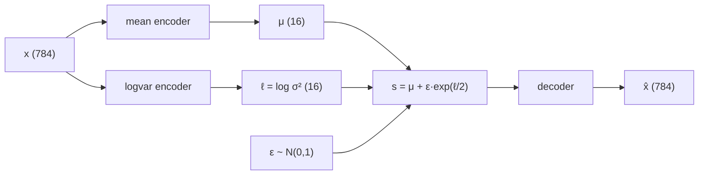

# Variational Autoencoder in NumPy

A variational autoencoder built from scratch in NumPy with **no reference code** and (nearly) **no AI** : 
forward pass, backpropagation, optimizer steps, and VAE latent space regularization by hand.

[Context](#context) · [Sources](#sources) · [How VAEs work](#how-vaes-work) · [Implementation notes](#implementation-notes) · [Results](#results) · [Discussion](#discussion)

---

## Context

After doing quite a bit of SFT on small LLMs for a research project, I realized I had little idea how training works under the hood. The training behind modern LLMs, which I take for granted, is built on years of R&D on learning paradigms, matrix factorization, synthetic data, autograd, Adam, and more.

A VAE was the first thing I built from a tutorial when I started learning PyTorch on just my laptop CPU. The goal of this project is to build a variational autoencoder (VAE) from scratch in NumPy with no AI* or reference code, and with the logic worked out by me through reading rather than explained via AI. All matrices and operations are plain NumPy arrays and native matrix multiplication, and every formula comes from math I read, watched explained, or derived myself (see [Sources](#sources)).

> **AI disclosure.** I would like to say I used no AI at all, but I had to ask an assistant for help with implementing the batched outer product as a NumPy operation, and also for making the plots in `assets/` look a bit nicer. But derivations and the core implementation are DIY.

**Repo contents.** Everything is in `numpy-VAE.ipynb`, organized as: (1) forward pass, (2) losses and backprop, (3) optimizers, (4) the VAE, (5) testing on MNIST. Dependencies: `numpy`, `matplotlib`, `tqdm`, `scikit-learn`, and `tensorflow` (only for the MNIST as numpy loader).

---

## Sources

Not everything I read, but the sources that I actually used in implementation. 

**Feed-forward networks**
- Michael Nielsen, [*Neural Networks and Deep Learning*](http://neuralnetworksanddeeplearning.com), ch. 1 and 2 (I did not read the accompanying code)

**Backpropagation and gradients**
- 3Blue1Brown, [*Backpropagation, intuitively*](https://www.youtube.com/watch?v=Ilg3gGewQ5U&vl=en) and [*Backpropagation calculus*](https://www.youtube.com/watch?v=tIeHLnjs5U8&vl=en)
- ritvikmath, [*Backpropagation: Data Science Concepts*](https://www.youtube.com/watch?v=kbGu60QBx2o)
- Paul's Online Math Notes, [Linear Approximations](https://tutorial.math.lamar.edu/classes/calci/linearapproximations.aspx). (calc 1 review!)
- Softmax derivative: [Wikipedia](https://en.wikipedia.org/wiki/Softmax_function) and [this Medium post](https://medium.com/data-science/derivative-of-the-softmax-function-and-the-categorical-cross-entropy-loss-ffceefc081d1) (which I ended up not using) 

**Optimizers (SGD, Adam)**
- [Stochastic gradient descent (Wikipedia)](https://en.wikipedia.org/wiki/Stochastic_gradient_descent)
- [Adam optimizer (GeeksforGeeks)](https://www.geeksforgeeks.org/deep-learning/adam-optimizer/)
- [Jacob Murri](https://www.jwmurri.com/) (UCLA), Math 118 lecture notes
- [Brendan Martin](https://bmartin9.github.io/) (UCLA), discussion section on Adam

**Variational autoencoders**
- Durk Kingma and Max Welling, [*An Introduction to Variational Autoencoders*](https://arxiv.org/abs/1906.02691). This was a bit more approachable than the original paper *Auto-encoding Variational Bayes*, but I still had to do a lot of side reading to follow it, since I haven't taken Bayesian statistics.
- [Autoencoder loss functions (apxml)](https://apxml.com/courses/introduction-autoencoders-feature-learning/chapter-3-how-autoencoders-learn/autoencoder-loss-functions)
- [Variational inference: derivation of the VAE loss function (Medium)](https://medium.com/retina-ai-health-inc/variational-inference-derivation-of-the-variational-autoencoder-vae-loss-function-a-true-story-3543a3dc67ee)
- [Help understanding reconstruction loss in VAE (Cross Validated)](https://stats.stackexchange.com/questions/323568/help-understanding-reconstruction-loss-in-variational-autoencoder)

---

## How VAEs work

<!-- TODO: template draft, rewrite in your own words. -->

**Autoencoders:** An autoencoder is composed of two neural networks trained to copy their input. The *encoder* squeezes an input (here a 784-pixel MNIST number) into a short vector in a lower-dimensional *latent space* (here 16 numbers), and the *decoder* tries to reconstruct the original image from the lower-dimensional encoding. 

**What a plain autoencoder is missing:** Nothing controls where the latent dimensional encoding lands. You would think that interpolating over a parameter changes a certain characteristic of the reconstructed number, but an arbitrary point in latent space often decodes to garbage, since training images end up as scattered points with large empty gaps in between. 

**The VAE addition:** Instead of mapping an image to a single point, the encoder outputs two vectors: a mean μ and a log-variance ℓ = log σ², which together describe a small Gaussian cloud around where the image lives. 
We get this through a second term in our loss. The *KL* term penalizes each Gaussian cloud for drifting from the standard normal N(0, I), making the model find a compromise between reconstruction quality and latent-space organization. A weight β sets the balance.

**Why we need sampling:** Because the decoder only ever sees noisy samples, nearby points in latent space must decode to similar images, so the space becomes smooth. After training you can draw s ~ N(0, I) and decode it to generate a new digit.

---

## Implementation notes

### 1. Denominator-layout vs NumPy's row vectors

All the math I've seen treats vectors as columns: $z = Wx + b$, with $W$ of shape `(out, in)`. But NumPy arrays behave like rows. To translate between the two layouts: 

$$Wx^T + b^T = z \implies z^T = xW^T+b$$

### 2. Backpropagation

Setup, for a layer $(L)$ with the layer before it labeled $(L-1)$:

$$z^{(L)} = W^{(L)}x^{(L-1)} + b^{(L)}, \qquad x^{(L)} = f\big(z^{(L)}\big)$$

where $f$ is an nonlinearity (sigmoid, ReLU, softmax, etc). The loss $C$ depends on every weight and bias, and we are trying to find $\frac{\partial C}{\partial W^{(L)}}$ and $\frac{\partial C}{\partial b^{(L)}}$. The only equation directly involving $W^{(L)}$ and $b^{(L)}$ is $z^{(L)}$, so it is enough to find $\frac{\partial C}{\partial z^{(L)}}$ for every linear layer and then apply one more chain-rule step.

**Last layer.** Take a sigmoid output $\hat y = \sigma(z^{(L)})$ and the loss $C = \frac12\sum_i(\hat y_i - y_i)^2$. Then $\frac{\partial C}{\partial \hat y} = \hat y - y$, and because the sigmoid acts elementwise, its Jacobian is diagonal ($\frac{\partial \sigma_i}{\partial z_j} = 0$):

$$\frac{\partial \hat y}{\partial z^{(L)}} = \operatorname{diag}\big(\hat y(1-\hat y)\big)$$

A diagonal matrix times a vector is just an elementwise product, so

$$\frac{\partial C}{\partial z^{(L)}} = \hat y(1-\hat y)\odot(\hat y - y)$$

**One layer back.** Chain rule through $x^{(L-1)}$:

$$\frac{\partial C}{\partial z^{(L-1)}} = \frac{\partial x^{(L-1)}}{\partial z^{(L-1)}}\,\frac{\partial z^{(L)}}{\partial x^{(L-1)}}\,\frac{\partial C}{\partial z^{(L)}} = \sigma'\big(z^{(L-1)}\big)\odot\left(\big(W^{(L)}\big)^\top\frac{\partial C}{\partial z^{(L)}}\right)$$

This recursion repeats at every layer. The only true matrix multiplication is by $W^\top$, while any vectorized nonlinearity is a hadamard product.

**Weights and biases.** Once $\frac{\partial C}{\partial z^{(L)}}$ is known:

$$\frac{\partial C}{\partial W^{(L)}} = \frac{\partial z^{(L)}}{\partial W} \frac{\partial C}{\partial z^{(L)}} = \frac{\partial C}{\partial z^{(L)}}\otimes x^{(L-1)}, \qquad \frac{\partial C}{\partial b^{(L)}} = \frac{\partial C}{\partial z^{(L)}}$$

where $\otimes$ is the outer product (shape `(out, in)`, matching $W$).

Derivation of the weight and bias gradients: 

Since $z^{(L)}_k = \sum_j W^{(L)}_{kj}\,x^{(L-1)}_j + b^{(L)}_k$,

$$\frac{\partial z^{(L)}_k}{\partial W^{(L)}_{ij}} = \begin{cases} x^{(L-1)}_j & i = k \\ 0 & i \neq k \end{cases}$$

Only $z^{(L)}_i$ depends on $W^{(L)}_{ij}$, so the sum over $k$ in the chain rule keeps a single term:

$$\frac{\partial C}{\partial W^{(L)}_{ij}} = \sum_k \frac{\partial z^{(L)}_k}{\partial W^{(L)}_{ij}}\frac{\partial C}{\partial z^{(L)}_k} = x^{(L-1)}_j\,\frac{\partial C}{\partial z^{(L)}_i}$$

That is the $(i, j)$ entry of the outer product above. For the bias, $\frac{\partial z^{(L)}_k}{\partial b^{(L)}_i}$ is $1$ if $i = k$ and $0$ otherwise, so $\frac{\partial C}{\partial b^{(L)}_i} = \frac{\partial C}{\partial z^{(L)}_i}$.

**The algorithm I figured out:**
1. Run the forward pass, storing each layer's input.
2. For a layer $\varphi$ with inputs $\rho$, find local derivative $\frac{\partial \varphi}{\partial \rho}$
3. For each $\rho$, find global derivative $\frac{\partial C}{\partial \varphi}$, and multiply the derivatives together: $\frac{\partial \varphi}{\partial \rho} \frac{\partial C}{\partial \varphi} = \frac{\partial C}{\partial \rho}$ 
4. At each linear layer, take $\frac{\partial C}{\partial z}$ and the layer's input $x^{(L-1)}$, then form the outer product for $\frac{\partial C}{\partial W}$ and copy $\frac{\partial C}{\partial z}$ for $\frac{\partial C}{\partial b}$.

**Batches.** With $B$ examples stored as rows, the gradient is the *mean of the per-example outer products*, not the outer product of the means. That sum of outer products is a single matmul:

| Column-vector math | NumPy (examples as rows) |
|---|---|
| $\quad \ z = W x + b$ | `x @ W.T + b` |
|$\quad \quad\quad \quad \frac{\partial C}{\partial W}$ | `dCdz.T @ x_prev / batch_size` |
| $\quad \quad\quad \quad \frac{\partial C}{\partial b}$ | `dCdz.mean(axis=0)` |

### 3. KL divergence

The full loss is a reconstruction term plus a weighted KL term:

For the reconstruction term I use squared error. With a Gaussian decoder of fixed variance, maximizing the likelihood of the data is equivalent to minimizing squared error. <!-- TODO: cite a source for this -->
The reconstruction error obviously depends on $\hat y$, but it also depends on the sample we get from $\mu$ and $\ell$. 

The KL divergence between the encoder's Gaussian $N(\mu, \sigma^2)$ and the standard normal has a closed form. Summed over the latent dimensions $d$, with $\ell = \log\sigma^2$:

$$\mathrm{KL}(\mu, \ell) = -\frac12\sum_d\left(1 + \ell_d - \mu_d^2 - \exp{\ell_d}\right)$$

<!-- TODO: link the source for this derivation. Too long to reproduce here. -->

$$\frac{\partial\,\mathrm{KL}}{\partial\mu} = \mu, \qquad \frac{\partial\,\mathrm{KL}}{\partial\ell} = \frac12\left(\exp\ell - 1\right)$$

Total loss function dependencies: 

$$C = L2(\hat y, \mu, \ell) + \beta\,\mathrm{KL}(\mu, \ell)$$

Without the KL term, the model gets good reconstruction but wants number categories isolated in latent space, so $\ell$ wants to become highly negative. 

### 4. The reparameterization trick

$z$ is already taken by linear-layers, so I call the sampled latent vector $r$ for reparameterized.

From intro stats, if $X \sim N(\mu, \sigma^2)$ then $(X - \mu)/\sigma$ is a standard normal. Run that backward: if $\varepsilon \sim N(0, 1)$ then $\mu + \sigma\varepsilon \sim N(\mu, \sigma^2)$. So instead of sampling from the distribution directly, I draw $\varepsilon$ and compute

$$r = \mu + \varepsilon\odot \exp{\ell/2}$$

This has the same distribution, but now $r$ is a differentiable function of $\mu$ and $\ell$, with the randomness isolated in $\varepsilon$. The encoder outputs the log-variance $\ell = \log\sigma^2$ rather than $\sigma$ itself because $\ell$ can be any real number while $\exp{\ell}$ is always positive.

The local derivatives are

$$\frac{\partial r}{\partial\mu} = I, \qquad \frac{\partial r}{\partial\ell} = \operatorname{diag}\left(\tfrac12\,\varepsilon\odot \exp{\ell/2}\right)$$

<!-- TODO: mark the KL terms above as implemented once the KL branch of VAE_loss.backward() is wired up. -->

---

## Results

<!-- TODO: add once training runs finish. Suggested contents:
- Reconstruction loss curve (images/reconstruction_loss.png)
- Mean / log-variance over training (images/latent_stats.png)
- Original vs. reconstructed digits
- 2D PCA of the 16-d latent means, colored by digit label
-->

---

## Discussion

### My backprop design vs. actual autograd engines
I never sat down fully and watched the Andrej Karpathy microcrad video in its 2-and-a-half-hour entirety, so after finishing this project I read/watched over a few sources on how people much smarter than I implemented the same logic. 

- **What I did:** each layer stores its input and output and has `prev`/`next` pointers, and the graph is hand-wired by either `NeuralNetwork.add` or by some other manual method. A recursive `_back(layer, global_grad)` walks backward; each layer multiplies the incoming global gradient by its local derivative and passes the result to `prev` as its global gradient. Parameter gradients are stored on the `LinearLayer` itself (`.g_weights`, `.g_biases`). 
- **Autograd** builds the graph dynamically during the forward pass; a graph connecting Function objects is created that maintains function gradients. In torch, calling `.backward()` on the graph root computes these gradients and attaches them to the respective tensor's `.grad` attribute. 

- **Two things I did first, before reverting to existing implementations:**
  - Recursing on $\frac{\partial C}{\partial z}$ only, skipping $\frac{\partial C}{\partial x}$ between layers. This worked for a plain chain and broke when I added the reparameterization node, which needs gradients with respect to its inputs.
  - Returning gradients from `backward`, then realizing attaching them to the parameters like torch was cleaner. But more on this below in the **Losses** section

<!-- - **Limits:** TODO (only the node types I wrote, whatever else) -->

### Forward passes
- **Forward:** My forward pass only maintains `input`/`output` for layers, and works on a simple recursive travel format, which works well for single input-output cases but breaks for multi. In torch, we define the forward pass by passing outputs into the next module, which I previously thought was being too explicit, but now it makes sense. 

### Losses, optimizers, suprises
-  **Loss:** I designed the `Loss` class based off of the way users interact with the torch training loop at a high level, specifically things like `nn.MSELoss` or `nn.BCELoss`. My implementation takes a reference to the model and its `backward` method calls the recursive chain-rule on the model's last layer.
In torch, a criterion just returns a tensor, and `backward` is called on the tensor, which becomes the root of the graph.
- Interestingly, the first optimizer approach I abandoned was where gradients are returned in a form matching the structure of the parameters, and then passed into `optimizer.step(grad)`. This is how TensorFlow and JAX/Optax work, but I've never seen a code snippet in any of these. 

- **Optimizers:** `torch.optim` classes are called on `model.parameters()` which was an approach I actually mirrored for a bit until I realized passing linear layers worked better once gradients were attached to the layers themselves. 
Torch optimizers save their current info in `state_dict`. By coincedence, I save current info in `Optimizer.state`, a dict which only got its name after I realized `Optimizer.prev` was taken by backpropagation layers. 

### Invalid inputs, clipping, and overflow
This may have taken more time than the backprop logic itself.
- **Overflow:** $\exp{\ell/2}$ in the reparameterization (and its gradient), and $\exp{-z}$ in the sigmoid caused overflow during forward/backward. Matrix weights were initialized uniformly on $[-1,1]$, but I realized that this caused early passes to explode. I eventually cut them down to $[-1e^{-6}, 1e^{-6}]$, but I should have done torch's approach of initializing based on the input dimensionality. 
- I ended the $\ell$ generator on a sigmoid for a while before I realized that reconstruction loss wants $\ell \rightarrow -\infty$. Loss plateaud in a local minimum where the network would reconstruct a ['mean number'](assets/mean-shape.png) from every example. 
- Real implementations will either clip outputs/gradients or use a stabilizer like BatchNorm before passing $z$ into the nonlinearity. 

### NumPy multiplication optimizations
- **Hadamard vs Matmul:** I explicitly constructed the jacobian from vectorized nonlinearities with `np.diag()` before finding out that NumPy doesn't optimize diagonal matrix multiplication, so I wrote the shape-case multiplication method that either used hadamard or regular matmul. 
- **Batched Jacobian needs tensors:** My approach never succesfully implemented batched Jacobian multiplication for things like the softmax function, as batched would mean the operation $J^Tx$ would have to multiply a `(batch, m, n)` by a `(batch, n)` to make a `(batch, m)` array. I'm sure this is efficiently possible in NumPy, but I've never used it. 
- **Implementations don't construct Jacobian:** Torch doesn't find $J$, it only needs $v^TJ$; for functions like sigmoid it's our same hadamard product, for something like softmax it apparently simplifies nicely. So the backward pass's only real matrix multiplication is to recurse with $xW^T$ and to find $\frac{\partial C}{\partial W}$ with the batched outer product as a matmul sum. 